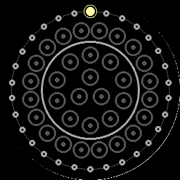
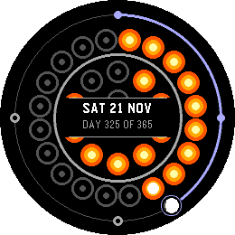
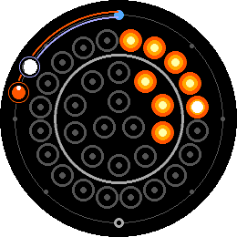
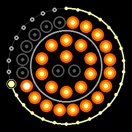

# Ignition

33 engines away from making life multiplanetary with this stellar watch face.
Moon phase and Mars transit complications, launch countdowns, and much more.

**[Get Ignition on the Rebble appstore](https://apps.rebble.io/en_US/application/6b025987bb43f20009804f0a)**
(it also appears in the Pebble app's store).

<p align="center">
  
  
  
</p>

Ignition is a watchface for the **Pebble Round 2**: a booster's engine plate
seen from below, where 33 engines tell the time.

## Reading it

- **AM/PM:** the top center engine is lit in the morning and dark after noon.
- **Hour:** the other 12 inner engines; that many are lit.
- **Minutes:** the outer 20 engines, one per three minutes. The newest burns white-hot.
- A thin ring, like a thrust puck's edge, separates the hour engines from the minute engines.

Engines flare as they ignite and flame out in sequence as they shut down, so the
top of every hour is a little shutdown-and-relight. Opening the face plays the
full startup sequence.

## The rim

The outer ring is a mission timeline: filled nodes have passed, the haloed node
is now. It shows one complication at a time:

| Complication | What it shows |
| --- | --- |
| Month (default) | One node per day; today is haloed |
| Hours | Jump hour, 12 nodes |
| Steps | Progress toward your daily goal |
| Day timeline | The whole day, with sunrise, solar noon and sunset for your location |
| T-minus | A countdown to a date you choose |
| Moon | One lunar cycle, with tonight's phase drawn in the marker |
| Moon & Mars | How far each is from Earth right now, and whether it's getting closer |
| Seconds | A seconds hand travelling the rim |

**Flick your wrist** (or **tap the screen**) to cycle through the complications
you've turned on, or to show one chosen complication, along with a date readout. It returns to your default after 5, 8 or 10 seconds (your choice).
Optionally, a flick also rearranges the engines between the startup sequence and
the clock-like dial while it's up.

### Throttle down

<p align="center">
  
</p>

Set **Flick readout** to **Throttle down** and a flick drops the lit engines to
embers, with the time and date glowing over them. When the flick ends the engines
relight in startup order, and once they're all back at full their heat takes the
lettering from white through amber, orange and red to charred black, until it
crumbles into embers that drift up and cool to ash.

There's also an easter egg for the next time Mars swings closest to Earth.

## Settings

Everything is in the watchface's settings page in the Pebble app: default rim,
which complications to cycle, flick and tap behaviour (including how long a flick
lasts, whether it rearranges the engines, and the date band or Throttle down), step goal, countdown date,
engine lighting order (clock-like or startup sequence), flame colour (orange,
methane blue-violet, white), an optional pulse for the current minute, and a
vibration when your phone disconnects.

## Privacy

No web services. Sun times, Moon and Mars distances and the next Mars closest
approach are computed on your phone. Your location is used only for sun times and
never leaves the phone; step counts come from the watch's health data.

## Building from source

Requires the [Pebble SDK](https://developer.repebble.com/) (`pebble-tool`).

```bash
pebble build
pebble install --emulator gabbro
```

The Moon distance uses the main terms of the lunar series from Meeus,
*Astronomical Algorithms*, and Mars uses JPL's approximate planetary elements.
The settings page is built with [Clay](https://github.com/pebble/clay)
(included as `src/pkjs/clay.js`, MIT licensed).
